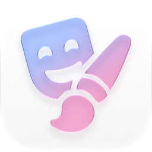

  

# Placard

Browse, create, install, and manage PosterBoard wallpapers on iOS.

- Browse community wallpapers and import `.tendies` packages
- Create video wallpapers from clips up to 12 seconds
- View and delete installed wallpapers
- English and Simplified Chinese

  

## Build

Requires Xcode 26+, iOS 26+, and a physical device compatible with `worse_query`.

Open `placard.xcodeproj`, select your signing team, and enable the App Group `group.$(PRODUCT_BUNDLE_IDENTIFIER)` in your provisioning profile. Build and run on your device.

## Credits

- [Pocket Poster](https://github.com/leminlimez/Pocket-Poster) — wallpaper workflow
- [GestaltEdit](https://github.com/frs0n/GestaltEdit) / [worse_query](https://github.com/forcequitOS/worse_query) — file access
- [nugget-wallpapers](https://github.com/SerStars/nugget-wallpapers) / [wallpapers](https://github.com/CAPlayground/wallpapers) — community catalog
- [NeoSpring](https://github.com/rooootdev/neospring) — SpringBoard refresh
- [ZIPFoundation](https://github.com/weichsel/ZIPFoundation) — archive handling

Wallpaper artwork belongs to its creators.

## License

[GPL-3.0](LICENSE). Incorporated code retains its upstream license.
